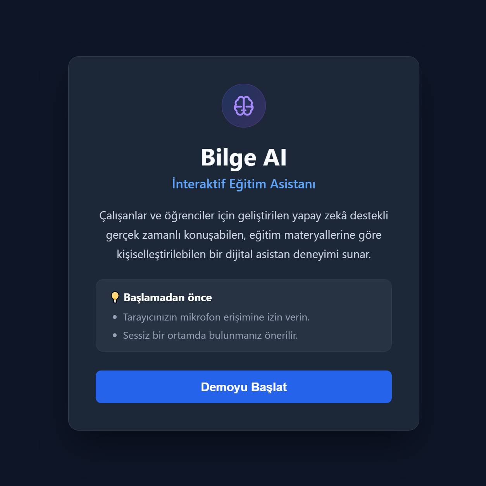
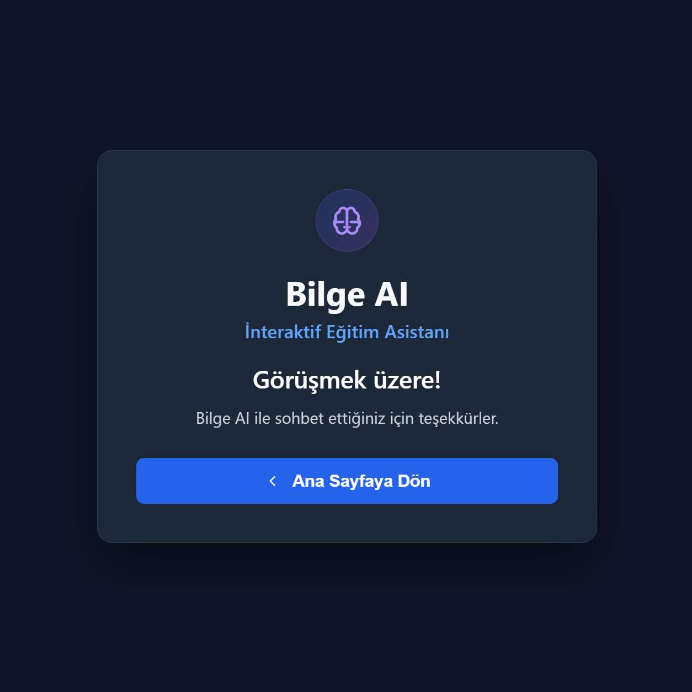
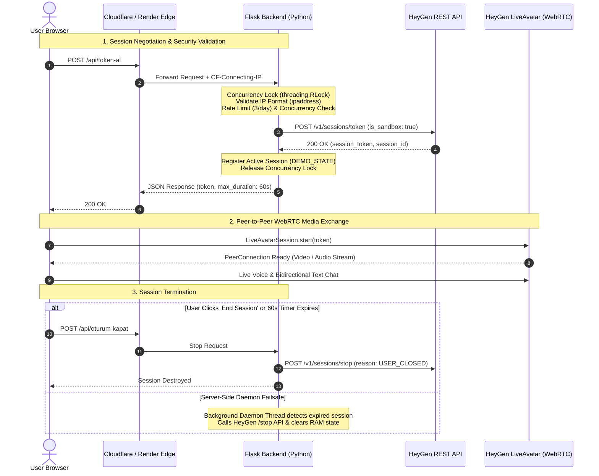

# Bilge AI — Interactive Learning Assistant

<p align="center">
  <a href="README.md"><strong>English</strong></a> | <a href="README.tr.md"><strong>Türkçe</strong></a>
</p>

<p align="center">
  <a href="LICENSE"></a>
  
  
  
  
  
  
  
</p>

---

## Overview

**Bilge AI** is an interactive, real-time AI learning platform designed for employees and students. Rather than relying on conventional, static text-based chat interfaces, it delivers an engaging, human-like learning experience powered by real-time digital avatar technology and conversational LLM capabilities provided through the **HeyGen LiveAvatar** infrastructure. The platform is engineered with a context-driven and configurable architecture, allowing it to be tailored to diverse educational topics and target audiences.

At its core, the backend architecture built with **Python, Flask, and Gunicorn** serves as the secure orchestration layer. It manages the full lifecycle of interactive sessions: dynamically binding the active persona context hosted on HeyGen via the configured context ID (`CONTEXT_ID`), isolating sensitive upstream credentials from the client, enforcing strict concurrency locks (`threading.RLock`) and client IP rate limits, and providing best-effort remote session termination and resource cleanup via an automated server-side daemon timer. The service is production-deployed on **Render** behind Cloudflare Edge protection.

🌐 **Live Demo:** [https://bilge-ai.onrender.com](https://bilge-ai.onrender.com)<br/>
*(Interactive sessions are constrained to 60 seconds with a rate limit of 3 sessions per IP per day to preserve shared sandbox resources.)*

---

## Screenshots

<p align="center">
  
  
</p>

---

## Purpose and Use Case

### General Educational Goal
Traditional digital learning often suffers from low engagement and one-way information consumption. Bilge AI bridges this gap by transforming digital training into an active, two-way conversational dialogue. By combining visual non-verbal cues, natural speech inflection, and context-bound reasoning, the platform fosters an interactive learning environment where learners actively discuss concepts, ask clarifying questions, and receive targeted, real-time feedback.

### Adaptable Platform Capabilities & Potential Use Cases
The platform's context-driven and configurable architecture enables adaptation across diverse potential learning scenarios:
* **Corporate Onboarding & Compliance:** Guiding newly joined employees through company policies, workflows, or compliance guidelines in a friendly, conversational format.
* **Student Mentoring & Academic Coaching:** Serving as an interactive academic tutor that reinforces key study topics, answers curriculum questions, and tests comprehension interactively.
* **Professional Skill Development:** Providing roleplay scenarios, interview preparation, and managerial communication exercises with real-time conversational responses.
* **Configurable Persona Context:** New learning personas can be created on HeyGen with custom knowledge and tone, then seamlessly integrated simply by supplying the corresponding `CONTEXT_ID` via environment configuration—requiring zero code changes in the backend.

### Current Demo: Task Prioritization & Eisenhower Matrix
The live demo currently deployed focuses specifically on **task prioritization and the Eisenhower Matrix** to demonstrate the platform's real-time capabilities in practice. In demanding workplace and academic environments, individuals frequently struggle to separate urgent firefighting tasks from truly important strategic goals. This active implementation features the **Bilge Özdemir** persona:

* **Focused Persona Context:** Governed by a dedicated persona context specifically bound to the four quadrants of the Eisenhower Matrix. The persona parameters and dialogue instructions are managed via a local `context.json` configuration file, which is maintained privately on the local machine and omitted from version control.
  > [!NOTE]
  > The Flask backend does not read `context.json` from the local filesystem at runtime. The active persona configuration is maintained directly on HeyGen and bound to the application via the `CONTEXT_ID` environment variable. Modifying the local `context.json` file alone will not alter the live avatar's behavior without updating the persona on HeyGen and referencing the corresponding `CONTEXT_ID`. To protect proprietary educational instructions and persona prompts, `context.json` is stored locally and excluded from Git tracking (`.gitignore`).
* **Proactive Dialogue Management:** Rather than merely answering user inputs passively, the avatar initiates contextual inquiries, offers structured insights, and tactfully steers off-topic conversations back to prioritization principles.
* **Multimodal Communication:** Supports seamless spoken conversation via low-latency WebRTC audio streaming alongside a synchronized, bidirectional text chat interface.

---

## Core Features

* **Real-Time Voice Streaming:** WebRTC-powered, low-latency audio/video rendering with lifelike lip-sync and voice responses.
* **Integrated Text Chat Drawer:** Slide-out, non-intrusive text chat panel allowing bidirectional messaging alongside the audio stream without video layout shifts.
* **Audio Controls:** Immediate microphone mute/unmute toggle.
* **Automated Cost & Session Control:** Hard 60-second session countdown, backed by an independent server-side daemon timer that forces remote session termination upon expiry.
* **Modern Dark Glassmorphism UI:** Responsive, distraction-free interface optimized for desktop and mobile displays.
* **Session Teardown Handling:** Dispatches remote session termination requests to HeyGen upon user exit (`reason: USER_CLOSED`) or 60s timeout (`MAX_DURATION_REACHED`), backed by background daemon retries.

---

## Tech Stack & Architecture

### Technology Overview

| Component | Technology | Version | Purpose |
| :--- | :--- | :--- | :--- |
| **Backend Runtime** | Python | `3.14` | Core application logic and background daemon thread management |
| **Web Framework** | Flask | `3.1.3` | REST API routing and HTML template delivery |
| **WSGI Server** | Gunicorn | `26.2.0` | Production HTTP server on Linux container |
| **WSGI Middleware**| Werkzeug | `3.1.9` | `ProxyFix(x_for=0, x_proto=1)` for secure HTTPS scheme detection |
| **HTTP Client** | Requests | `2.34.2` | Communicates with HeyGen LiveAvatar REST API |
| **Avatar Engine** | HeyGen LiveAvatar Web SDK | `esm.sh` | Client-side WebRTC session lifecycle and media handling |
| **Testing** | Pytest / Unittest | `9.0.3` | Comprehensive test suite (27 automated tests) |
| **Dependency Audit**| pip-audit | `2.10.1` | Automated dependency vulnerability verification (0 known CVEs at scan date) |
| **Hosting Platform**| Render | Cloud (PaaS) | Containerized deployment with Cloudflare edge proxy |

---

### System Architecture Diagram

The architecture explicitly decouples backend API orchestration from client-side WebRTC media streaming:



---

## Backend Architecture & REST API

The backend maintains in-memory state tracking (`DEMO_STATE`) protected by `threading.RLock` to eliminate race conditions without database overhead.

### API Endpoints

#### 1. `GET /`
Renders the single-page application interface. Serves production assets and initializes client state.

#### 2. `POST /api/token-al`
Requests a short-lived session token from HeyGen.
* **Client Verification & Limits:** Validates client IP against rate limits and concurrent session bounds.
* **Payload Generated:** Requests `mode: "FULL"`, `is_sandbox: true/false`, and binds the persona context.
* **Responses:**
  - `200 OK`: Returns `{ "durum": true, "token": "...", "session_id": "...", "max_sure_sn": 60 }`.
  - `400 Bad Request`: Client IP verification failed.
  - `429 Too Many Requests`: Daily limit reached (3/3) or another session is actively running.
  - `500 Internal Server Error`: Upstream connection error.

#### 3. `POST /api/oturum-kapat`
Terminates the active HeyGen session for the calling client IP.
* **Action:** Dispatches `POST /v1/sessions/stop` to HeyGen and resets server state.
* **Responses:**
  - `200 OK`: `{ "durum": true, "mesaj": "Oturum sonlandırıldı." }`.
  - `400 Bad Request`: Client IP verification failed.
  - `500 Internal Server Error`: Remote HeyGen stop failed; session flagged for daemon retry.

#### 4. `POST /api/oturum-kilidi-kaldir` (Admin Diagnostic)
Emergency unlock endpoint designed for local debugging.
* **Production Behavior:** Returns `404 Not Found` unconditionally in production.
* **Local Behavior:** Accessible only when `ENABLE_ADMIN_API=true`, caller is localhost (`127.0.0.1` or `::1`), and the payload matches `ADMIN_SECRET` validated using constant-time `hmac.compare_digest()`.

---

## Security & Cost Engineering

Because third-party avatar streaming APIs incur per-minute costs, the backend implements defense-in-depth measures against abuse:

### 1. Client IP Verification (`CF-Connecting-IP`)
* Behind Render's proxy architecture, `X-Forwarded-For` headers can be spoofed or contain arbitrary comma-separated values.
* In production, the backend strictly relies on the **`CF-Connecting-IP`** header injected and sanitized by Cloudflare at the edge.
* Validated using Python's standard library `ipaddress.ip_address()`. Malformed headers or comma injections immediately return HTTP 400.
* Werkzeug's `ProxyFix` is explicitly configured as `x_for=0, x_proto=1` to prevent unvetted rewriting of client socket addresses while preserving HTTPS scheme detection.

### 2. Concurrency Control & Anti-Spam
* **Race Condition Mitigation:** Critical state checks and token creation calls are guarded by `threading.RLock()`. Concurrent HTTP requests cannot trigger duplicate HeyGen session allocations.
* **Quota Enforcement:** IP usage is tracked in memory; each unique IP is restricted to 3 sessions per calendar day.
* **Global Single Session:** The demo allows only 1 concurrent user worldwide to prevent credit drainage.

### 3. HTTP Security Headers
All responses include hardened security headers:
* **Content-Security-Policy (CSP):** Restricts script, frame, and media execution while permitting essential WebRTC protocols (`connect-src 'self' https: wss:; media-src 'self' blob: https:;`).
* **Frame Protection:** `X-Frame-Options: DENY` and `frame-ancestors 'none'` to mitigate clickjacking.
* **MIME Sniffing:** `X-Content-Type-Options: nosniff`.
* **Referrer Policy:** `Referrer-Policy: strict-origin-when-cross-origin`.

---

## Sandbox vs. Production Modes

| Dimension | Sandbox Mode (`SANDBOX_MODE=True`) | Live/Paid Mode (`SANDBOX_MODE=False`) |
| :--- | :--- | :--- |
| **API Cost** | **Free ($0.00)** | Consumes account streaming credits |
| **Avatar Model** | HeyGen test model (`dd73ea75-1218-4ef3-92ce-606d5f7fbc0a`) | Custom corporate avatar model (`AVATAR_ID`) |
| **Request Payload**| `is_sandbox: true` sent to HeyGen API | `is_sandbox: false` sent to HeyGen API |
| **Safety Fallback**| **Safe Default:** If `SANDBOX_MODE` is mistyped or unset, the system defaults to Sandbox mode. | Only activates when explicitly set to `"False"`. |

> **Note:** For portfolio demonstration and public testing, Bilge AI is configured in **Sandbox Mode** by default.

---

## Local Setup & Configuration

### Prerequisites
* Python 3.14 (tested)
* A valid HeyGen LiveAvatar API Key (optional for testing test suite)

### 1. Clone the Repository
```bash
git clone https://github.com/ozdemirkaya/bilge-ai.git
cd bilge-ai
```

### 2. Create Virtual Environment
```bash
python -m venv venv

# Windows
venv\Scripts\activate

# macOS / Linux
source venv/bin/activate
```

### 3. Install Dependencies
```bash
pip install -r requirements.txt
```

### 4. Configure Environment Variables
Create a `.env` file in the project root based on `.env.example`:

```ini
# Core Configuration
HEYGEN_API_KEY=your_heygen_api_key_here
SANDBOX_MODE=True
DEMO_DEV_TOOLS=False

# Live Mode IDs (Required only when SANDBOX_MODE=False)
AVATAR_ID=your_avatar_id_here
CONTEXT_ID=your_context_id_here

# Local Administration & Diagnostics
ADMIN_SECRET=your_secure_random_admin_secret
ENABLE_ADMIN_API=False
ENVIRONMENT=development
```

### 5. Run Development Server
```bash
python app.py
```
Open your browser and navigate to `http://127.0.0.1:5001`.

---

## Running Automated Tests

The repository includes a comprehensive automated test suite consisting of **27 unit, integration, and security regression tests**:

```bash
python -m pytest tests/ -v
```

### Test Suite Highlights
* **Authentication & Error Handling:** Mocked HeyGen API HTTP 400, 401, 422, and 500 failure responses.
* **Concurrency & Race Conditions:** Simulated multi-threaded burst requests ensuring only 1 session token is allocated.
* **IP Security & Anti-Spoofing:** Validates that forged `X-Forwarded-For` headers are ignored and `CF-Connecting-IP` is enforced.
* **Quota Isolation:** Verifies distinct client IPs maintain independent quotas.
* **Production Admin Shield:** Validates that admin recovery routes strictly return HTTP 404 under production flags.

---

## Known Limitations & Roadmap

* **In-Memory State (`DEMO_STATE`):** Rate limits and active session states are currently maintained in RAM. If the application server restarts or spins down, in-flight state is reset. Production scaling would benefit from external state storage like **Redis**.
* **Orphaned Session Edge Case:** If the hosting instance is abruptly terminated by the host during an active session, the background daemon cannot execute the `/stop` call. HeyGen's internal timeout serves as the upstream failsafe.
* **Live Paid Mode Rollout:** Enabling paid LiveAvatar sessions for public traffic is not recommended without database-backed user authentication and payment/billing throttling.

---

## Project Structure

```text
bilge-ai/
├── app.py                  # Core Flask server, security middleware, and routes
├── requirements.txt        # Pinned production dependencies
├── recover_session.py      # CLI script for local administrative recovery
├── templates/
│   └── index.html          # Single-page application with LiveAvatar SDK integration
├── tests/
│   └── test_demo.py        # 27 automated test cases
├── docs/
│   └── assets/             # Directory for application screenshots
├── .env.example            # Sanitized environment variable template
├── .gitignore              # Git exclusion rules
├── LICENSE                 # MIT License file
├── SECURITY.md             # Responsible disclosure and security policy
├── README.md               # English project documentation
└── README.tr.md            # Turkish project documentation
```

---

## License

This project is licensed under the **MIT License** - see the [LICENSE](LICENSE) file for details.

---

## Author & Contact

**Özdemir Kayan**<br/>
*Junior Backend Developer*

* [GitHub Profile](https://github.com/ozdemirkaya)
* Live Project: [https://bilge-ai.onrender.com](https://bilge-ai.onrender.com)
