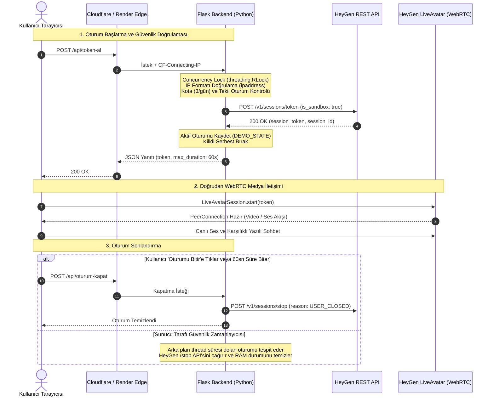

# Bilge AI — İnteraktif Eğitim Asistanı

<p align="center">
  <a href="README.md"><strong>English</strong></a> | <a href="README.tr.md"><strong>Türkçe</strong></a>
</p>

<p align="center">
  <a href="LICENSE"></a>
  
  
  
  
  
  
  
</p>

---

## Genel Bakış

**Bilge AI**, çalışanlar ve öğrenciler için geliştirilmiş yapay zekâ destekli, etkileşimli ve gerçek zamanlı bir dijital eğitim asistanı platformudur. Alışılagelmiş metin tabanlı sohbet pencerelerinin ötesine geçerek, **HeyGen LiveAvatar** altyapısı üzerinden çalışan gerçek zamanlı dijital avatar ve sesli LLM teknolojileriyle insana yakın bir öğrenme deneyimi sunar. Platform, eğitim konularına ve hedef kitleye göre kişiselleştirilebilir esnek bir mimariye sahiptir.

Sistemin kalbinde yer alan **Python, Flask ve Gunicorn** tabanlı backend mimarisi; güvenli orkestrasyon katmanı olarak görev yapar. Oturum yaşam döngüsünü yönetir, HeyGen üzerinde barındırılan aktif persona bağlamını (`CONTEXT_ID`) dinamik olarak bağlar, hassas API kimlik bilgilerini istemciden gizler, eşzamanlılık kilitleri (`threading.RLock`) ve IP sınırlandırmaları uygular. Süresi dolan oturumları arka planda otomatik olarak sonlandıran koruyucu bir sunucu zamanlayıcısına (daemon thread) sahiptir. Uygulama, **Render** üzerinde Cloudflare Edge koruması altında canlı olarak yayımlanmaktadır.

🌐 **Canlı Demo:** [https://bilge-ai.onrender.com](https://bilge-ai.onrender.com)<br/>
*(Paylaşılan sandbox kaynaklarını korumak amacıyla interaktif oturumlar 60 saniye ve IP başına günlük 3 oturum ile sınırlandırılmıştır.)*

---

## Ekran Görüntüleri

<p align="center">
  
  
</p>

---

## Amaç ve Kullanım Senaryoları

### Genel Eğitim Hedefi
Geleneksel dijital eğitim süreçlerinde karşılaşılan en büyük problem, tek taraflı bilgi aktarımı ve düşük kullanıcı etkileşimidir. Bilge AI; jest, mimik, doğal ses tonu ve bağlama duyarlı akıl yürütme yetenekleriyle eğitimi çift taraflı, etkileşimli bir diyaloğa dönüştürerek bu engeli aşmayı hedefler. Kullanıcı dinleyici konumundan çıkarak doğrudan asistanla konuşur, sorular sorar ve anlık geri bildirim alır.

### Uyarlanabilir Platform Yetenekleri ve Potansiyel Kullanım Alanları
Sistem bağlama duyarlı ve yapılandırılabilir yapısı sayesinde farklı eğitim ihtiyaçlarına göre kolaylıkla uyarlanabilir:
* **Kurumsal Oryantasyon ve Uyum:** Yeni işe başlayan çalışanlara şirket politikalarını, prosedürleri ve iş güvenliği kurallarını samimi ve interaktif bir rehberlikle aktarma.
* **Öğrenci Mentorluğu ve Akademik Koçluk:** Ders konularını pekiştiren, soruları yanıtlayan ve öğrencinin konuyu kavrama düzeyini interaktif sorularla test eden dijital rehber.
* **Profesyonel Yetkinlik Geliştirme:** Mülakat simülasyonları, müşteri iletişimi ve liderlik senaryolarında gerçek zamanlı rol yapma (roleplay) pratikleri.
* **Yapılandırılabilir Persona Bağlamı:** HeyGen üzerinde farklı uzmanlıklara sahip yeni eğitim personaları oluşturulabilir ve arka uç kodunda hiçbir değişiklik yapmadan yalnızca `CONTEXT_ID` çevre değişkeni güncellenerek sisteme bağlanabilir.

### Mevcut Demo Konusu: Görev Önceliklendirme ve Eisenhower Matrisi
Sistemin şu an yayında olan canlı demosu, platformun yeteneklerini somutlaştırmak amacıyla **görev önceliklendirme ve Eisenhower Matrisi** konusuna odaklanmaktadır. Yoğun çalışma ve eğitim hayatında kişilerin en çok zorlandığı acil işler ile önemli hedefleri ayırt etme becerisini kazandırmak için **Bilge Özdemir** personası yapılandırılmıştır:

* **Odaklanmış Persona Bağlamı:** Asistanın uzmanlık alanı Eisenhower Matrisi'nin 4 çeyreğiyle sınırlandırılmıştır. Persona parametreleri ve yönlendirme talimatları, yerel makinede özel olarak tutulan ve Git takibine dahil edilmeyen `context.json` dosyasında yönetilmektedir.
  > [!NOTE]
  > Flask backend, çalışma anında `context.json` dosyasını yerel diskten doğrudan okumaz. Aktif persona yapılandırması HeyGen üzerinde tutulur ve uygulamaya `CONTEXT_ID` çevre değişkeni üzerinden bağlanır. Yerel `context.json` dosyasını değiştirmek tek başına canlı avatarı değiştirmez; HeyGen üzerindeki personanın güncellenmesi ve ilgili `CONTEXT_ID`'nin bağlanması gerekir. Özel eğitim yönergelerini ve promptları korumak amacıyla `context.json` yerel bilgisayarda korunmakta ve Git takibinden hariç tutulmaktadır (`.gitignore`).
* **Yönlendirici Diyalog Yönetimi:** Kullanıcının sorularını yalnızca pasif şekilde yanıtlamakla kalmaz; proaktif sorular sorarak konuyu matrisin mantığına çeker ve konu dışı sohbetleri nazikçe önceliklendirme ilkelerine geri döndürür.
* **Çok Modlu (Multimodal) İletişim:** Kullanıcı isterse sesli konuşabilir, isterse ekranı daraltmadan açılan yan panel üzerinden yazılı mesajlaşabilir.

---

## Temel Özellikler

* **Gerçek Zamanlı Ses Akışı:** WebRTC üzerinden düşük gecikmeli, dudak senkronizasyonlu ses ve video aktarımı.
* **Entegre Yazılı Sohbet Paneli:** Video düzenini bozmadan sağ taraftan açılan çift yönlü yazılı mesajlaşma desteği.
* **Mikrofon Yönetimi:** Kullanıcı arayüzünden tek tıkla ses açma/kapatma (mute/unmute) denetimi.
* **Otomatik Maliyet ve Süre Kontrolü:** 60 saniyelik geri sayım sayacı ve süresi dolan oturumları sunucu tarafında zorla kapatan bağımsız arka plan thread'i.
* **Modern Koyu Glassmorphism Tasarım:** Masaüstü ve mobil ekranlara uyumlu, göz yormayan arayüz.
* **Sunucu Tarafı Güvenli Kapatma:** Kullanıcı ayrıldığında (`reason: USER_CLOSED`) veya süre bittiğinde (`MAX_DURATION_REACHED`) HeyGen oturumunu güvenle sonlandıran hata dayanımlı API orkestrasyonu.

---

## Teknoloji Yığını ve Mimari

### Kullanılan Teknolojiler

| Bileşen | Teknoloji | Sürüm | Görev |
| :--- | :--- | :--- | :--- |
| **Backend Çalışma Zamanı** | Python | `3.14` | Çekirdek uygulama mantığı ve arka plan thread yönetimi |
| **Web Çerçevesi** | Flask | `3.1.3` | REST API rotaları ve HTML şablon sunumu |
| **WSGI Sunucusu** | Gunicorn | `26.2.0` | Linux konteyner üzerinde üretim HTTP sunucusu |
| **WSGI Middleware**| Werkzeug | `3.1.9` | Güvenli HTTPS tespiti için `ProxyFix(x_for=0, x_proto=1)` |
| **HTTP İstemcisi** | Requests | `2.34.2` | HeyGen LiveAvatar REST API ile arka uç iletişimi |
| **Avatar Motoru** | HeyGen LiveAvatar Web SDK | `esm.sh` | İstemci tarafı WebRTC oturum ve medya yönetimi |
| **Test Çerçevesi** | Pytest / Unittest | `9.0.3` | 27 adet otomatik test senaryosu |
| **Zafiyet Denetimi**| pip-audit | `2.10.1` | Bağımlılık güvenlik taraması (0 bilinen CVE) |
| **Barındırma** | Render | Cloud (PaaS) | Cloudflare edge korumalı konteyner dağıtımı |

---

### Sistem Mimari Şeması

Mimari, arka uç API orkestrasyonu ile istemci tarafı doğrudan WebRTC medya akışını birbirinden ayıracak şekilde tasarlanmıştır:



---

## Backend Mimarisi ve REST API

Backend, veritabanı maliyetine girmeden yarış durumlarını (race condition) engellemek için `threading.RLock` ile korunan bellek içi durum takibi (`DEMO_STATE`) yürütür.

### API Uç Noktaları

#### 1. `GET /`
Tek sayfalık web arayüzünü render eder. Gerekli statik varlıkları ve arayüz durumunu başlatır.

#### 2. `POST /api/token-al`
HeyGen üzerinden kısa ömürlü bir oturum tokenı talep eder.
* **İstemci Doğrulaması ve Limitler:** İstemci IP adresinin günlük limitini ve eşzamanlı aktif oturum durumunu denetler.
* **Oluşturulan İstek:** `mode: "FULL"`, `is_sandbox: true/false` bayraklarını ve persona bağlamını ekler.
* **Yanıtlar:**
  - `200 OK`: `{ "durum": true, "token": "...", "session_id": "...", "max_sure_sn": 60 }`.
  - `400 Bad Request`: İstemci IP doğrulaması başarısız.
  - `429 Too Many Requests`: Günlük limit doldu (3/3) veya başka bir oturum aktif.
  - `500 Internal Server Error`: HeyGen sunucusuyla iletişim hatası.

#### 3. `POST /api/oturum-kapat`
İsteği gönderen IP adresine ait aktif HeyGen oturumunu sonlandırır.
* **İşlem:** HeyGen'e `POST /v1/sessions/stop` isteği gönderir ve yerel durumu temizler.
* **Yanıtlar:**
  - `200 OK`: `{ "durum": true, "mesaj": "Oturum sonlandırıldı." }`.
  - `400 Bad Request`: İstemci IP doğrulaması başarısız.
  - `500 Internal Server Error`: HeyGen tarafında hata oluştu; oturum arka plan retry mekanizmasına devredildi.

#### 4. `POST /api/oturum-kilidi-kaldir` (Admin Tanılama)
Yerel hata ayıklama süreçleri için tasarlanmış acil durum kilit kaldırma uç noktasıdır.
* **Production Davranışı:** Canlı ortamda koşulsuz olarak `404 Not Found` döner.
* **Local Davranışı:** Yalnızca `ENABLE_ADMIN_API=true` olduğunda, istek sahibi `127.0.0.1` veya `::1` olduğunda ve gönderilen anahtar sabit zamanlı `hmac.compare_digest()` ile doğrulandığında çalışır.

---

## Güvenlik ve Maliyet Yönetimi

Canlı avatar akış servisleri dakika bazlı maliyet ürettiğinden, arka uç suistimallere karşı çok katmanlı savunma önlemleriyle donatılmıştır:

### 1. İstemci IP Doğrulaması (`CF-Connecting-IP`)
* Render proxy mimarisi arkasında `X-Forwarded-For` başlığı istemci tarafından manipüle edilebilir.
* Üretim ortamında sistem kesinlikle Cloudflare tarafından garanti edilen **`CF-Connecting-IP`** başlığını baz alır.
* Python'ın standart `ipaddress.ip_address()` kütüphanesiyle doğrulanır; formatı bozuk veya virgülle ayrılmış sahte başlıklara anında HTTP 400 döner.
* Werkzeug `ProxyFix`, istemci IP'sini kontrolsüz değiştirmemek için `x_for=0, x_proto=1` olarak ayarlanmıştır.

### 2. Eşzamanlılık Denetimi ve Spam Engelleme
* **Race Condition Koruması:** Durum kontrolleri ve token alma süreçleri `threading.RLock()` ile korunur. Aynı anda gelen çoklu istekler mükerrer oturum başlatamaz.
* **Kota Takibi:** IP başına günlük kota bellekte takip edilir; her IP günde en fazla 3 oturum başlatabilir.
* **Küresel Tekil Oturum:** Kredi tüketimini kontrol altında tutmak için dünya genelinde aynı anda yalnızca 1 aktif oturuma izin verilir.

### 3. HTTP Güvenlik Başlıkları
Tüm yanıtlarda modern güvenlik başlıkları zorunlu kılınmıştır:
* **Content-Security-Policy (CSP):** Yalnızca güvenilir kaynaklara ve gerekli WebRTC bağlantılarına (`connect-src 'self' https: wss:; media-src 'self' blob: https:;`) izin verir.
* **Tıklama Tuzağı Koruması:** `X-Frame-Options: DENY` ve `frame-ancestors 'none'` ile iframe içinde çalıştırılması engellenir.
* **MIME Tipi Koruması:** `X-Content-Type-Options: nosniff`.
* **Yönlendirme İlkesi:** `Referrer-Policy: strict-origin-when-cross-origin`.

---

## Sandbox ve Canlı Mod Karşılaştırması

| Kriter | Sandbox Modu (`SANDBOX_MODE=True`) | Gerçek/Canlı Mod (`SANDBOX_MODE=False`) |
| :--- | :--- | :--- |
| **API Maliyeti** | **Ücretsiz ($0.00)** | Canlı yayın kredisi harcar |
| **Avatar Modeli** | HeyGen test modeli (`dd73ea75-1218-4ef3-92ce-606d5f7fbc0a`) | Özel kurum avatarı (`AVATAR_ID`) |
| **API İstek Verisi** | HeyGen API'sine `is_sandbox: true` gönderilir | HeyGen API'sine `is_sandbox: false` gönderilir |
| **Hata Güvenliği (Typo)** | **Güvenli Varsayılan:** Değişken hatalı yazılsa veya boş kalsa bile sistem varsayılan olarak Sandbox modunda kalır. | Yalnızca açıkça `"False"` değeri atandığında devreye girer. |

> **Önemli:** Portföy sunumu ve herkese açık testler için Bilge AI varsayılan olarak **Sandbox Modu**nda çalışacak şekilde yapılandırılmıştır.

---

## Yerel Kurulum ve Yapılandırma

### Gereksinimler
* Python 3.14 (test edilen sürüm)
* Geçerli bir HeyGen LiveAvatar API Anahtarı (test paketini çalıştırmak için zorunlu değildir)

### 1. Depoyu Klonlayın
```bash
git clone https://github.com/ozdemirkaya/bilge-ai.git
cd bilge-ai
```

### 2. Sanal Ortam Oluşturun
```bash
python -m venv venv

# Windows
venv\Scripts\activate

# macOS / Linux
source venv/bin/activate
```

### 3. Bağımlılıkları Yükleyin
```bash
pip install -r requirements.txt
```

### 4. Çevre Değişkenlerini Tanımlayın
Proje kök dizininde `.env.example` dosyasını temel alarak bir `.env` dosyası oluşturun:

```ini
# Temel Yapılandırma
HEYGEN_API_KEY=your_heygen_api_key_here
SANDBOX_MODE=True
DEMO_DEV_TOOLS=False

# Gerçek Mod ID'leri (Yalnızca SANDBOX_MODE=False olduğunda gereklidir)
AVATAR_ID=your_avatar_id_here
CONTEXT_ID=your_context_id_here

# Yerel Yönetim ve Tanılama
ADMIN_SECRET=your_secure_random_admin_secret
ENABLE_ADMIN_API=False
ENVIRONMENT=development
```

### 5. Geliştirme Sunucusunu Başlatın
```bash
python app.py
```
Tarayıcınızda `http://127.0.0.1:5001` adresine gidin.

---

## Otomatik Testlerin Çalıştırılması

Proje, **27 adet otomatik birim, entegrasyon ve güvenlik regresyon testi** içeren kapsamlı bir test paketi ile korunmaktadır:

```bash
python -m pytest tests/ -v
```

### Test Paketi Kapsamı
* **Yetkilendirme ve Hata Yönetimi:** HeyGen API'sinin 400, 401, 422 ve 500 hata durumlarının simülasyonu.
* **Eşzamanlılık ve Race Condition:** Çok kanallı (multi-threaded) eşzamanlı isteklerde yalnızca 1 oturum açıldığının kanıtı.
* **IP Güvenliği ve Spoofing Koruması:** Sahte `X-Forwarded-For` başlıklarının yoksayıldığı ve `CF-Connecting-IP`'nin doğrulandığı testler.
* **Kullanıcı İzolasyonu:** Farklı istemci IP'lerinin kotalarının birbirinden bağımsız çalıştığının doğrulanması.
* **Production Admin Koruması:** Canlı mod bayrağı altında admin kurtarma rotasının kesinlikle 404 döndüğünün testi.

---

## Bilinen Sınırlamalar ve Gelecek Geliştirmeler

* **Bellek İçi Durum Yönetimi (`DEMO_STATE`):** Kota ve aktif oturum bilgileri RAM üzerinde tutulmaktadır. Sunucu yeniden başladığında bu durum sıfırlanır. Dağıtık ve ölçeklenebilir bir üretim ortamı için **Redis** entegrasyonu önerilir.
* **Sunucu Çökmesi ve Sahipsiz Oturum Riski:** Sunucu çalışırken beklenmedik şekilde aniden sonlanırsa, arka plan temizleme thread'i HeyGen `/stop` çağrısını yapamayabilir. Bu durumda HeyGen'in kendi iç zaman aşımı mekanizması devreye girer.
* **Gerçek Mod Canlı Dağıtımı:** Ücretli LiveAvatar oturumlarının genel erişime açılması; veritabanı destekli kullanıcı kimlik doğrulaması ve ödeme/fatura sınırlama katmanları eklenmeden önerilmemektedir.

---

## Proje Dizin Yapısı

```text
bilge-ai/
├── app.py                  # Çekirdek Flask sunucusu, güvenlik middleware'leri ve rotalar
├── requirements.txt        # Sabitlenmiş üretim bağımlılıkları
├── recover_session.py      # Yerel yönetimsel kurtarma için CLI betiği
├── templates/
│   └── index.html          # LiveAvatar SDK entegrasyonlu tek sayfalık web arayüzü
├── tests/
│   └── test_demo.py        # 27 adet otomatik test senaryosu
├── docs/
│   └── assets/             # Uygulama arayüz ekran görüntüleri
├── .env.example            # Güvenli çevre değişkenleri şablonu
├── .gitignore              # Git istisna kuralları
├── LICENSE                 # MIT Lisansı belgesi
├── SECURITY.md             # Sorumlu güvenlik açığı bildirim politikası
├── README.md               # İngilizce proje dokümantasyonu
└── README.tr.md            # Türkçe proje dokümantasyonu
```

---

## Lisans

Bu proje **MIT Lisansı** ile lisanslanmıştır - ayrıntılar için [LICENSE](LICENSE) dosyasına bakın.

---

## Geliştirici ve İletişim

**Özdemir Kayan**<br/>
*Junior Backend Developer*

* [GitHub Profili](https://github.com/ozdemirkaya)
* Canlı Proje: [https://bilge-ai.onrender.com](https://bilge-ai.onrender.com)
